# Santulan: a research prototype for clinician-led diabetes dose review

Santulan is a research prototype for clinician-led medication review in Type 2 diabetes. It combines clinical context with CGM history, evaluates personalised glucose forecasting on real patients under a leak-free protocol, and offers explicitly assumption-based dose scenarios for discussion. The doctor decides; nothing here changes a dose.

**Happiest Health Digital Twin Challenge 2026 — Prototype & Code Submission**  
Team **Heartificial Intelligence**, **Indian Institute of Management Mumbai**. Repository/folder: `Heartificial-Intelligence_IIM-Mumbai`.

## Submission checklist

| Required item | Location / status |
| --- | --- |
| Team details | [Registered team and leader](#team-details) |
| College/incubator information | [IIM Mumbai](#college) |
| Project title | **Santulan: a research prototype for clinician-led diabetes dose review** |
| Problem statement | [Problem statement](#problem-statement) |
| Healthcare use case | [Clinical workflow and intended outcomes](#healthcare-use-case) |
| Technical stack | [Languages, libraries and interface](#technical-stack) |
| AI/ML model or framework details | [Calibration, physiology core, LightGBM and evaluation](#aiml-model-and-framework) |
| Unlisted YouTube demo video | **Pending final video URL** — [demo status and supporting clips](#demo-video) |
| Open-source licence details | [Apache-2.0 code and CC BY 4.0 source data](#open-source-licence) |
| Architecture diagram in PDF/PPT format | [Architecture PDF](docs/architecture.pdf) |
| Presentation covering project details and outcomes | [17-slide PDF](docs/presentation.pdf) · [PowerPoint with speaker notes](docs/presentation.pptx) |
| Public access to required files and links | [Repository access](#public-access); final YouTube access remains pending |

The [challenge page](https://unstop.com/hackathons/crp-digital-twin-challenge-2026-happiest-health-1757873) and submission form require the video link in this README. The submission package remains incomplete until that link is added and checked without signing in.

[Submission audit](docs/submission_audit.md): document checks, test results, dataset provenance and the remaining video step.

**What is measured, what is illustrative, what is proposed**

| Part | Status | Evidence |
| --- | --- | --- |
| Personal calibration: 5-day CGM, frozen sensor offset, physiology core fitted per person | Implemented | Real data, 85 sensor periods |
| Glucose forecasts at 30, 60 and 120 minutes (hybrid twin) | Implemented and evaluated | Retrospective, held-out patients |
| Low alert (simple rule on the corrected reading) | Implemented and evaluated | Retrospective; models compared at equal alert budgets |
| Live replay of a real held-out patient, same feature and inference code as the evaluation | Implemented | Parity tested against stored predictions and the alert log |
| Clinician-review triggers (GLP-1 start, weight loss, planned fast, kidney function) and safety notes (G6PD, CYP2C9, age) | Implemented as stated rules | Rules only; not clinically validated |
| Dose scenarios on a person's physiology core | Illustrative | Simulated, comparative, uncalibrated; sensitivity shown |
| Sensor-off glucose estimation | Experimental | Real data, at most 8.0 days per period; cannot detect lows |
| Smartwatch data | Display only | Synthetic Health Connect shapes; not used by any model |
| ABDM FHIR records | Example shapes | Not validated against the profiles |
| Quarterly sensor fortnights, Indian calibration, clinical outcomes | Proposed | Needs a prospective pilot |

**Results on 76 real held-out patients (ShanghaiT2DM, evaluation protocol v2)**

| Question | Result |
| --- | --- |
| 2-hour forecast error (RMSE) | **32.6 mg/dL** (95% CI 30.2 to 35.1) against **40.7** for "no change": **20%** lower |
| Does the physiology core help? | Yes: at 2 hours it lowers error by **2.2 mg/dL** when added to machine learning without the clinical record, and by **1.1 mg/dL** in the full hybrid (both intervals exclude zero) |
| Does the static clinical record improve forecasts? | No: with the physiology core present it is slightly worse at 30 and 60 minutes (+0.2 and +0.5 mg/dL) and no different at 2 hours. It drives the review rules instead |
| Do the models improve low alerts? | Not shown: at the same budget of 0.5 alerts a day, a simple rule on the current reading caught **43 of 53** CGM-defined lows; the hybrid forecast caught **29 of 53**, while emitting fewer alerts on held-out patients (0.37 a day against 0.50) |
| Sensor-off estimation | RMSE **29.6 mg/dL** against 33.6 (typical day) and 52.2 (last fingerstick), but only **1 of 213** readings below 70 was estimated below 80 |

**Submission items:** [Team](#team-details) · [College](#college) · [Title](#santulan-a-research-prototype-for-clinician-led-diabetes-dose-review) · [Problem statement](#problem-statement) · [Healthcare use case](#healthcare-use-case) · [Technical stack](#technical-stack) · [AI/ML model](#aiml-model-and-framework) · [Demo video](#demo-video) · [Licence](#open-source-licence) · [Architecture diagram](#architecture-diagram) · [Presentation](#presentation) · [Public access](#public-access)

## Team details

**Team name:** Heartificial Intelligence

| Role | Name | Programme and college |
| --- | --- | --- |
| Team leader | Shubham Sunil Patil | MBA, Indian Institute of Management Mumbai |
| Team member | Adarsh Nayan | Indian Institute of Management Mumbai |

## College

Indian Institute of Management (IIM) Mumbai.

## Problem statement

**In one line:** adults with Type 2 diabetes on sulfonylureas or insulin are exposed to low blood sugar when their body changes but their dose does not, and clinicians have little structured support for deciding when a dose should come down.

- **Burden.** India has 10.1 crore adults with diabetes ([ICMR-INDIAB](https://nmji.in/lessons-learnt-from-the-icmrindiab-study)). About half are treated, and about half of those take a sulfonylurea or insulin ([LANDMARC](https://doaj.org/article/57997eb5dcc94d18a610e0249ced28fc)): roughly 2.5 crore people. Applying published yearly rates of severe lows (5% on sulfonylureas, 21% on insulin; [meta-analysis of 5.3 lakh people](https://journals.plos.org/plosone/article?id=10.1371/journal.pone.0126427)), we estimate about 25 lakh severe lows a year (range 13 to 48 lakh). This is an estimate of the problem's size, not of anything this prototype prevents.
- **Lows are often silent.** In older adults wearing a sensor, 80 to 100% of lows went unnoticed ([review](https://ueaeprints.uea.ac.uk/67231)). At KEM Hospital, Mumbai, sulfonylurea reactions caused 48 of 164 drug-reaction admissions ([JCDR 2022](https://doaj.org/article/bba8e078022a46b88726bf9dfc0bca3a)).
- **The body changes; the dose often does not.** Generic semaglutide reached India in March 2026 ([South First](https://thesouthfirst.com/health/generic-semaglutide-launches-in-india-after-patent-expiry-prices-drop-sharply/)). With a sulfonylurea it brings lows in 17 to 24% of people, against 2 to 4% alone, and the label advises considering a lower sulfonylurea or insulin dose ([label rates](https://mdedge.com/content/reducing-or-discontinuing-insulin-or-sulfonylurea-when-initiating-glucagon-peptide-1-agonist)). Weight loss, fasting and falling kidney function push the same way.
- **Doses rarely come down.** Among 89,987 US adults aged 65 and over, 48% were below their sugar goal, yet only 9.4% (2019) to 16.9% (2023) had treatment reduced ([Drug Topics, on JAMA Internal Medicine](https://www.drugtopics.com/view/diabetes-medications-adjustments-for-older-adults-lower-than-ada-guidelines)).
- **The gap we address.** CGM apps predict the next low, and some already do it well ([Roche SmartGuide](https://www.roche.co.uk)). We found none that brings the body changes that make a dose too strong together with the patient's CGM history for a clinician's review, or lets the clinician compare step-down options side by side.

## Healthcare use case

**In one line:** when a patient on a sulfonylurea or insulin has a body change, a physician uses Santulan to see the patient's recent glucose, forecasts and the review rules that fired, compares illustrative step-down options, and decides.

| Who | What they get |
| --- | --- |
| Physician (endocrinology or general practice) | The review rules that fired and why, the CGM history with forecasts, a simple low alert, and side-by-side illustrative scenarios with their assumptions |
| Patient on a sulfonylurea or insulin, especially aged 60 and over | A medication review triggered when their body changes, instead of at a fixed interval |

**How it would fit into care**

1. **Calibrate.** A 14-day CGM sensor with a few fingersticks fits the person's physiology core and sensor offset (5 days are used for calibration here).
2. **Watch.** With the CGM on, a simple low alert and 30 to 120-minute forecasts.
3. **Review.** A GLP-1 start, 5% weight loss, a planned fast or eGFR below 60 flags the record for review, with the drug-label note behind each rule.
4. **Discuss.** The physician compares step-down options on the person's core, with assumptions shown and adjustable.
5. **Decide and re-sense.** The physician decides. A new sensor period recalibrates the twin.

Sensor-off estimation between sensor periods is experimental. In our data it tracked the glucose level but did not detect lows, and longer sensor-off use is untested.

**One illustrative patient.** Meena, 62 (synthetic), takes glimepiride 2 mg with metformin 500 mg as a fixed-dose combination twice daily. Twice-daily dosing of this combination is common in Indian practice ([real-world study of 7,058 patients at 347 Indian sites](https://pmc.ncbi.nlm.nih.gov/articles/PMC7920844)), though the [US label](https://dailymed.nlm.nih.gov/dailymed/drugInfo.cfm?setid=28eefc95-d92e-4555-b6c5-2933860b0610) specifies once daily. Six weeks after starting semaglutide she has lost 5% of her weight, and her eGFR is 58. Four review rules fire: GLP-1 start, weight loss, a planned fast and kidney function. Her physiology coefficients are copied from one real patient's fitted core.

Under the stated assumptions, unchanged doses give simulated lows on 99% of nights. Halving the evening dose gives 7.5%, but that figure ranges from 0% to 33% across noise settings, and up to 80% under a stronger kidney assumption. Without the kidney assumption, unchanged doses give 18%. These numbers rank options under assumptions. They are not risk estimates, and the treatment effects are unvalidated.

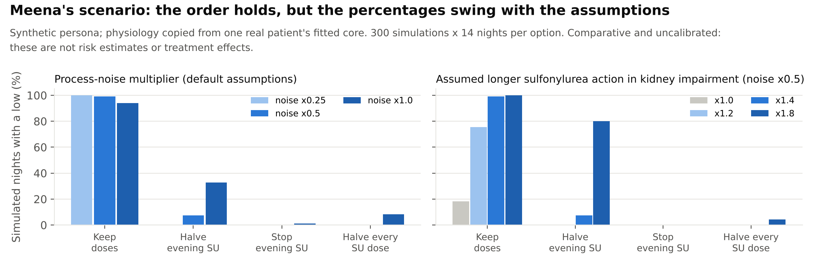

**Where it could be piloted.** Happiest Health's Endocrinology and Your Personal Physician clinic in Koramangala, its planned obesity and Healthy Ageing clinics, and Project Khushi. Wellness success, such as weight loss or lower sugar, is exactly when doses may need review ([report](https://www.tripurastarnews.com/happiest-health-expands-project-khushi-with-bengaluru-city-police-to-reach-600-personnel-over-three-years/)).

**What a pilot must show.** We make no claim of prevented lows, lives saved or cost savings. A prospective pilot with consented Indian patients on a sulfonylurea or insulin would measure:

- severe hypoglycaemia needing assistance;
- CGM time below 70 mg/dL;
- dose reductions made and their outcomes;
- false-alert burden;
- clinician acceptance;
- the body-change effects that the scenarios currently assume.

## Results on real patients

**Data.** ShanghaiT2DM: 100 adults with Type 2 diabetes, 109 CGM periods with fingersticks, meals and every dose ([Scientific Data](https://www.nature.com/articles/s41597-023-01940-7), CC BY 4.0).

**Protocol.** [`docs/evaluation_protocol.md`](docs/evaluation_protocol.md), frozen before running. Each person is calibrated on a fixed 5 days after a 24-hour warm-up, and only those days set their sensor offset, meal fill and physiology core. Population models are tested on held-out patients in 5 patient folds, with the offset prior and alert thresholds fitted on training patients only. No input uses data from after a forecast's origin, and tests enforce this. 85 periods from 76 patients qualify (24 shorter periods excluded); 538 monitored patient-days.

**Version 1 was superseded.** An audit found that the first evaluation let later data in: the sensor offset used later fingersticks, and alarm scoring was inconsistent. Its numbers, including the earlier "50 of 54 lows caught" and "2-hour error 33.2", are kept in [`results/legacy_2026-10-19/`](results/legacy_2026-10-19/) and not quoted. Every change, with its test evidence and remaining limitation, is listed in [`IMPLEMENTATION_CHANGELOG.md`](IMPLEMENTATION_CHANGELOG.md).

### 1. Forecasts

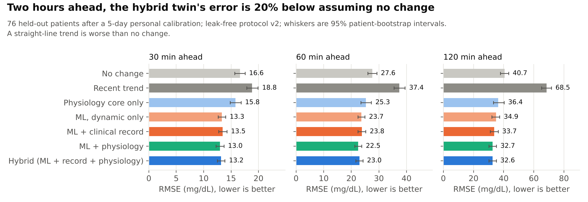

<!-- generated by scripts/summarise.py: forecast table -->
| RMSE (mg/dL) | 30 min | 60 min | 120 min |
| --- | --- | --- | --- |
| No change (persistence) | 16.6 | 27.6 | 40.7 |
| Recent trend extrapolated | 18.8 | 37.4 | 68.5 |
| Physiology core only | 15.8 | 25.3 | 36.4 |
| Machine learning, dynamic only | 13.3 | 23.7 | 34.9 |
| Machine learning + clinical record | 13.5 | 23.8 | 33.7 |
| Machine learning + physiology | 13.0 | 22.5 | 32.7 |
| **Hybrid: ML + clinical record + physiology (primary)** | **13.2** | **23.0** | **32.6** (30.2 to 35.1) |
<!-- end of generated table -->

The primary hybrid's 2-hour error is 20% below no change. MARD and Clarke A+B for every method are in [`results/evaluation.json`](results/evaluation.json).

### 2. What each ingredient adds

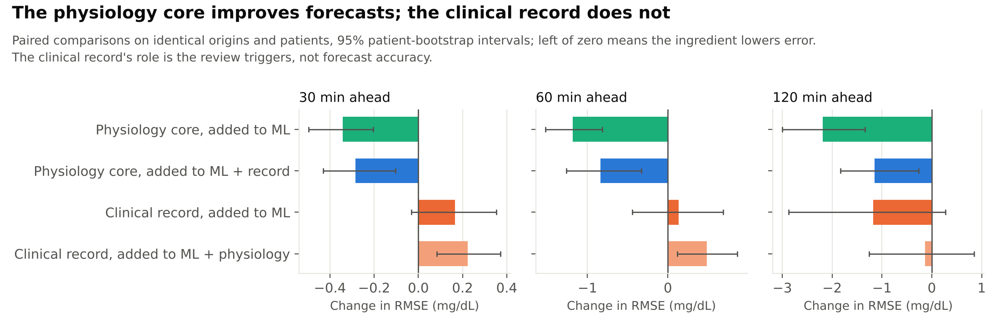

- **Physiology core.** Adding it lowers 2-hour error by 2.2 mg/dL (paired 95% interval 1.3 to 3.0) to machine learning without the clinical record, and by 1.1 mg/dL (0.3 to 1.8) in the full hybrid.
- **Clinical record (EHR).** Adding it does not improve forecasts. With the physiology core present it makes error slightly worse at 30 and 60 minutes (+0.2 and +0.5 mg/dL, intervals excluding zero) and makes no difference at 2 hours.
  - Once the twin is calibrated to the person, the next two hours depend on recent readings, doses and meals.
  - The record matters for who is flagged and which assumptions apply: medicines, eGFR, weight, genetics and fasting plans drive the review rules.
  - This comparison was planned to stay private; it is published because the brief asks for EHR fusion and the result is negative.

### 3. Low alerts

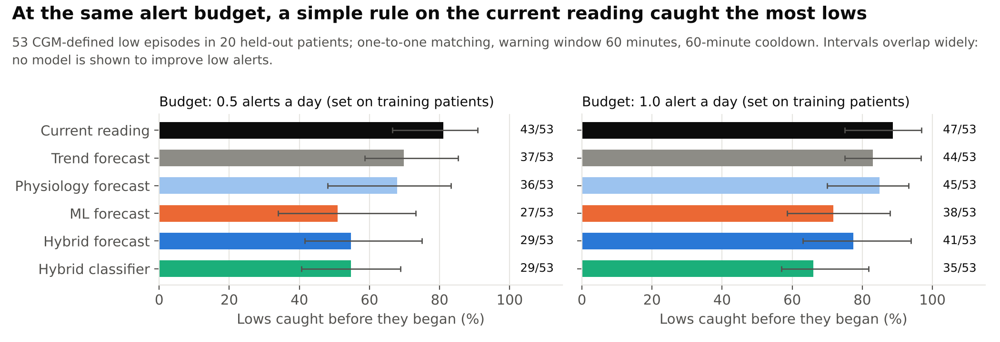

- **One alert policy for every method.** Fire when the score passes its threshold, never during an ongoing low, with a 60-minute cooldown from the last emitted alert.
- **Scoring.** One-to-one matching, crediting only alerts 0 to 60 minutes before an episode starts. False alerts count only when the following hour was observed.
- **Thresholds.** Each method's threshold meets an alert budget on training patients only.
- **Events.** 53 CGM-defined episodes (at least 15 minutes below 70 mg/dL) in 20 held-out patients. These are sensor-defined, not severe clinical events.

<!-- generated by scripts/summarise.py: alert table -->
| Alert score (thresholds set on training patients) | Lows caught, budget 0.5 a day | Alerts a day on held-out patients | False alerts a day | Alert precision | Lows caught, budget 1.0 a day |
| --- | --- | --- | --- | --- | --- |
| **Current corrected reading** | **43 of 53** | 0.50 | 0.42 | 16% | 47 of 53 |
| Trend forecast, 30 min | 37 of 53 | 0.50 | 0.42 | 14% | 44 of 53 |
| Physiology core forecast, 30 min | 36 of 53 | 0.47 | 0.40 | 14% | 45 of 53 |
| Machine learning forecast, 30 min | 27 of 53 | 0.36 | 0.31 | 14% | 38 of 53 |
| Hybrid forecast, 30 min | 29 of 53 | 0.37 | 0.32 | 14% | 41 of 53 |
| Hybrid classifier, low within 60 min | 29 of 53 | 0.40 | 0.34 | 14% | 35 of 53 |
<!-- end of generated table -->

- **Wider budget.** At 1.0 alert a day the simple rule caught 47 of 53 and the hybrid 41 of 53 (last column).
- **Equal budgets, not equal realised rates.** Thresholds are set on training patients. On held-out patients the learned scores emitted fewer alerts than their budget (0.36 to 0.40 a day at the 0.5 budget) while the simple rule emitted 0.50. Even at the 1.0 budget, where the hybrid emitted 0.81 alerts a day, it caught 41, fewer than the simple rule's 43 at the 0.5 budget.
- **The learned alert results are fragile.** Two small corrections on 24 October (inner-fold offset priors, and causal pump-basal pulses) moved the hybrid from 36 to 35 to 29 of 53 at the 0.5 budget, while the simple rule caught 43 in every run.
- **Raw, uncorrected CGM.** On 149 raw episodes the hybrid caught 88 against 73 for the simple rule.
- **Our reading.** The models are **not shown to improve low alerts**, so the prototype alerts on the simple rule and shows the forecasts for context. Median warning was 15 minutes at the primary budget.
- **Classifier.** The low-within-60-minutes classifier has AUROC 0.83 but AUPRC 0.11 at a 0.39% prevalence.

### 4. Experimental sensor-off estimation

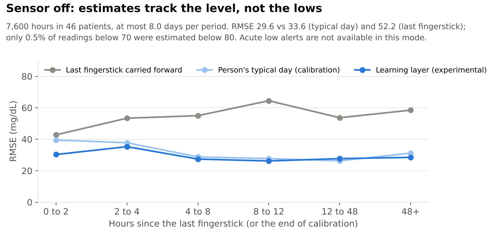

- **Setup.** After calibration the CGM was hidden. The core started from the last calibration reading and saw only doses, meals and fingersticks; hidden CGM is used only for scoring.
- **Accuracy.** Over 46 patients a learning layer reached RMSE 29.6 mg/dL, against 33.6 for the person's typical day and 52.2 for the last fingerstick carried forward.
- **Lows.** It estimated only 1 of 213 readings below 70 as below 80, so **acute low alerts are not available without a CGM**.
- **Coverage.** At most 8.0 days per period; weeks of sensor-off use are untested.

### 5. Descriptive sensor check

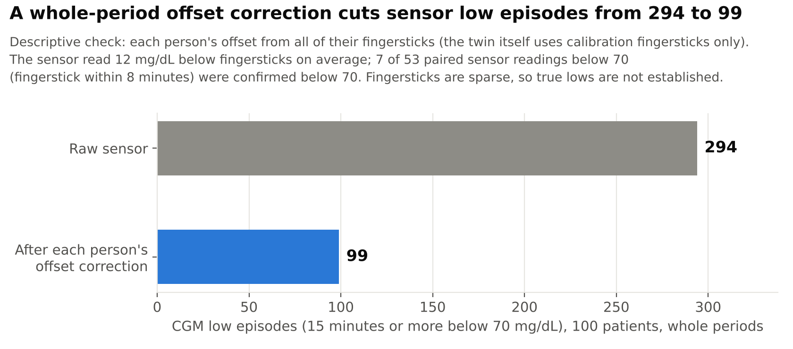

- **Bias.** Across 2,883 CGM-fingerstick pairs within 8 minutes, the sensor read 12 mg/dL below fingersticks, close to a published 12.8 mg/dL for this sensor family ([Diabetes Care 2020](https://scholarship.miami.edu/esploro/outputs/journalArticle/Comparison-of-the-FreeStyle-Libre-Pro/991031816797902976)).
- **Confirmation.** Of 53 sensor readings below 70 that had a fingerstick within 8 minutes, only 7 were confirmed below 70 by the fingerstick.
- **Effect of correction.** A descriptive whole-period correction (each person's offset from all of their fingersticks, shrunk towards a whole-cohort prior) changes the episode count from 294 to 99. The twin itself does not use this: it learns each offset from calibration fingersticks only. Sparse fingersticks do not establish true lows, and this check is not used by any forecast.

## AI/ML model and framework

Santulan is a hybrid digital twin: a physiology core personalised to each person, plus population learning models evaluated on held-out patients.

1. **Calibration** (`twin/calibration.py`, `twin/sensor.py`).
   - Fixed 5 days after a 24-hour warm-up.
   - Sensor offset from calibration fingerstick pairs only, shrunk to a training-patient prior, then frozen.
   - Meal fill from calibration meals.
   - Baseline drug flags from records before the cutoff.
2. **Input curves** (`twin/inputs.py`, `twin/drugs.py`, `twin/meals.py`).
   - Insulin action curves for rapid, regular, NPH and basal analogues.
   - Exposure curves for sulfonylureas and GLP-1 drugs.
   - Meal carbohydrate from food names and weights.
   - At any time only events logged up to that time count.
3. **Physiology core** (`twin/model.py`).
   - A linearised Bergman minimal model extended with drug exposure and a daily rhythm.
   - Fitted per person by sign-constrained, lightly regularised least squares (`scipy.optimize.lsq_linear`), so each coefficient keeps its meaning.
4. **Learning layer** (`scripts/evaluate.py`, `twin/features.py`).
   - LightGBM models predict the 30, 60 and 120-minute change from CGM history, logged inputs, the clinical record and the core's own forecasts.
   - Four ablation arms are evaluated. Settings are fixed, not tuned.
5. **Alert policy** (`twin/alerts.py`). One policy and one scorer, shared by the evaluation and the replay.
6. **Live replay** (`twin/replay.py`).
   - Steps a real held-out patient through time, using only records up to the clock and the fold model that excluded the patient.
   - Its forecasts reproduce the evaluation's stored predictions to within 0.000001 mg/dL (tested).
   - A jump control moves the clock to 75 minutes before any CGM low episode in the period, caught or missed. With "reveal" on, the dashboard shows the evaluation's own score for the latest alert (matched, false, redundant or censored), read from `results/alerts.csv.gz`.
7. **Review rules** (`twin/triggers.py`).
   - GLP-1 start within 16 weeks, 5% weight loss, a planned fast within 14 days, eGFR below 60.
   - Safety notes for G6PD deficiency, CYP2C9 variants and age 65 and over.
   - Judged as of an injected date. Missing genetics stay "not tested".
8. **Scenarios** (`twin/whatif.py`).
   - A routine is simulated on the core under each option.
   - Process noise is scaled by an explicit multiplier (0.25, 0.5, 1.0), and the body-change effects are stated, adjustable assumptions.
   - Sensitivity is in [`results/scenario_sensitivity.json`](results/scenario_sensitivity.json).

## Technical stack

| Layer | Tools |
| --- | --- |
| Language | Python 3.11 or later (tested on 3.13) |
| Data | pandas, NumPy, openpyxl, xlrd |
| Physiology core | SciPy (`lsq_linear`, gamma curves) |
| Learning layer | LightGBM, scikit-learn (patient-grouped folds, metrics) |
| Dashboard | Streamlit, Plotly |
| Figures and documents | Matplotlib, Chromium (HTML to PDF) |
| Records | Example FHIR R4 bundle shapes modelled on the ABDM implementation guide v6.5.0 ([NRCeS](https://www.nrces.in/ndhm/fhir/r4/profiles.html)); wearable data in Android Health Connect record shapes. Not validated against those profiles. |
| Tests | pytest |
| Cost | No paid services; the full evaluation runs on a laptop in about 10 minutes |

## Architecture diagram

PDF: [`docs/architecture.pdf`](docs/architecture.pdf). Each component is marked implemented, illustrative, experimental or proposed.

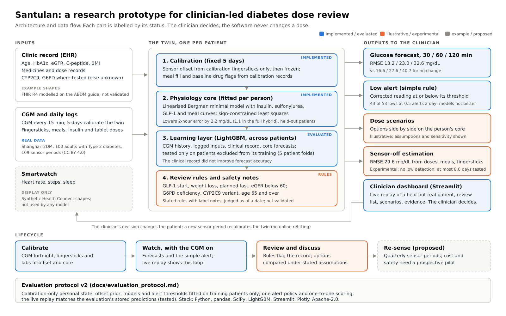

## Demo video

**Status: the final narrated demo is being prepared; its unlisted YouTube URL is pending.**

The submission form specifies 15–20 minutes and the public challenge page specifies a minimum of 20 minutes. A **20-minute** walkthrough meets both stated durations. The two short supporting clips below do not replace this required video.

Two short screen recordings of the dashboard are in `docs/`:

- [`docs/demo_1_live_replay.mp4`](docs/demo_1_live_replay.mp4) (2:47): the live replay on a real held-out patient. One low is missed (the reading was 79.5 mg/dL, just above the 79 threshold, 15 minutes before it began), one night-time low is warned 60 minutes ahead, then a sensor dropout, a synthetic GLP-1 start and a reset.
- [`docs/demo_2_clinic_tour.mp4`](docs/demo_2_clinic_tour.mp4) (2:01): the synthetic clinic list, Meena's record, dose scenarios with a changed assumption, the evidence tab and example record shapes.

Both are scripted (`python scripts/record_demo.py`, with the dashboard running), so a rerun shows the same states; `docs/demo_cues.json` lists the time of each on-screen caption.

## Presentation

PDF: [`docs/presentation.pdf`](docs/presentation.pdf). The same 17 slides as a PowerPoint file, with the video script in the speaker notes (slides are embedded images; the HTML source is also included): [`docs/presentation.pptx`](docs/presentation.pptx).

## Dashboard

| Live replay (real held-out patient) | Clinic list (synthetic) |
| --- | --- |
| 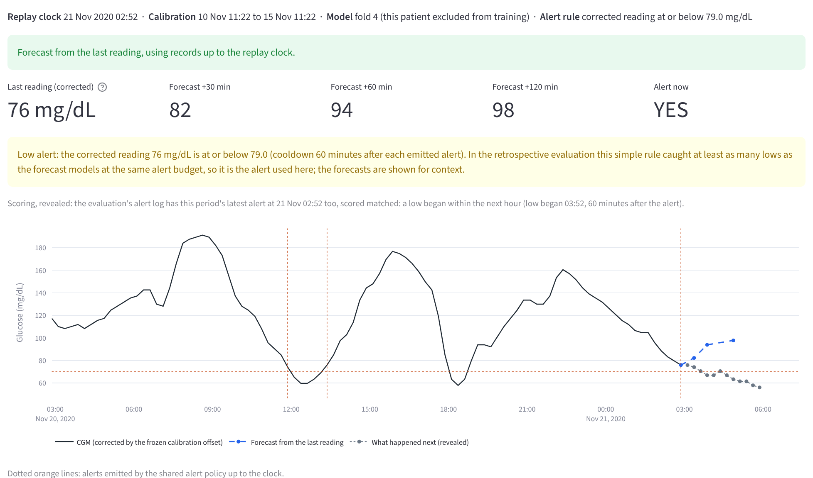 | 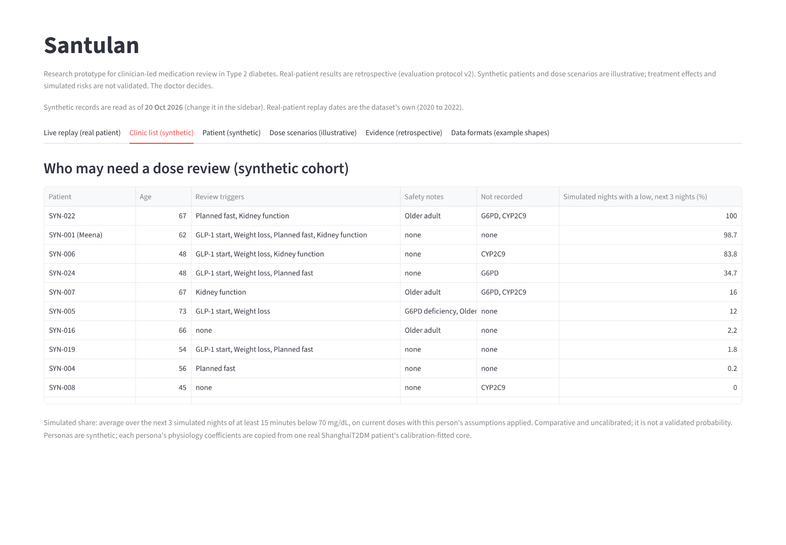 |
| **Dose scenarios (illustrative)** | **Evidence (retrospective)** |
| 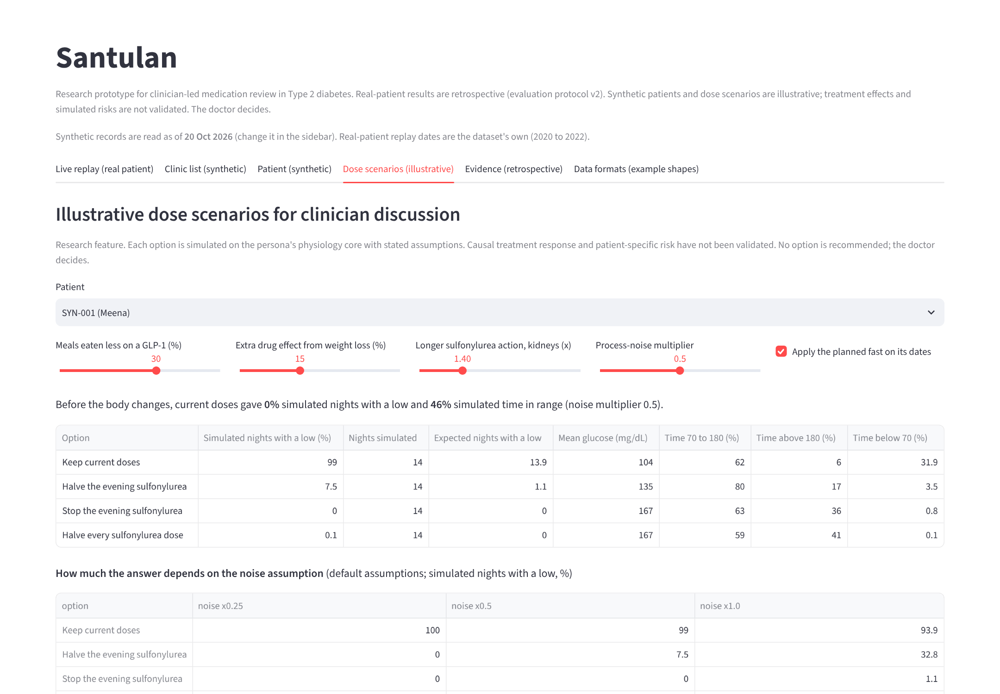 | 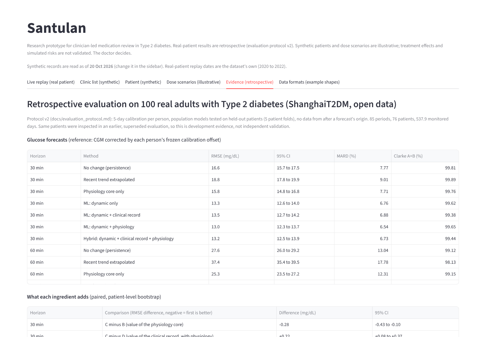 |

## How to run

Use Python 3.13. Run these commands from the repository root. On macOS, install the LightGBM runtime dependency first: `brew install libomp`.

### Quick start with the included results

```bash
git clone https://github.com/Nayanwho/Heartificial-Intelligence_IIM-Mumbai.git
cd Heartificial-Intelligence_IIM-Mumbai
python3 -m venv .venv
source .venv/bin/activate                # Windows PowerShell: .venv\Scripts\Activate.ps1
python -m pip install -r requirements.txt
python -m streamlit run app/dashboard.py
```

Open `http://localhost:8501`. The repository includes data, fitted models and results, so the dashboard does not require retraining, an API key or a cloud service.

### Tests and full regeneration (optional)

With the same environment active:

```bash
python -m pytest -q tests                # validate the included package
python scripts/run_all.py                # every step below, in order (about 15 to 20 minutes)

# or step by step:
python scripts/data_check.py             # descriptive sensor check (about 10 seconds)
python scripts/evaluate.py               # version-2 evaluation, both references (about 15 minutes)
python scripts/make_cohort.py            # synthetic demo cohort
python scripts/scenario_sensitivity.py   # scenario sensitivity grid
python scripts/summarise.py              # headline numbers, and the README's result tables
python scripts/make_figures.py           # figures
python -m pytest -q tests                # all tests
python -m streamlit run app/dashboard.py  # dashboard at http://localhost:8501
```

[`requirements-lock.txt`](requirements-lock.txt) records the exact versions used for the original Linux evaluation; install it instead of `requirements.txt` to reproduce that environment. Regeneration rewrites result files, synthetic records, figures and the generated README tables. The saved evaluation is retrospective development evidence, not a prospective clinical validation.

## Reproducibility

- **Protocol:** [`docs/evaluation_protocol.md`](docs/evaluation_protocol.md). Its SHA-256 hash is recorded in the run manifest.
- **Run manifest:** [`results/manifest.json`](results/manifest.json) holds data and code hashes, the seed, library versions, the configuration and exclusions.
- **Fold assignment:** [`results/folds.json`](results/folds.json), seed 7.
- **Calibration boundaries, offsets and fitted cores:** [`results/calibrations.csv`](results/calibrations.csv).
- **Predictions:** every prediction with its origin is in [`results/predictions.csv.gz`](results/predictions.csv.gz); every emitted alert is in [`results/alerts.csv.gz`](results/alerts.csv.gz).
- **Saved models:** per-fold models in [`results/models/`](results/models/), each trained without its fold's patients.
- **Where the numbers come from:** the two result tables in this README are written by `scripts/summarise.py` from [`results/evaluation.json`](results/evaluation.json). Other numbers in this README, the deck, the architecture and the video script are typed, and `tests/test_docs_consistency.py` checks them against [`results/summary.json`](results/summary.json), which the same script generates.
- **What the tests guard:**
  - later data cannot change an earlier feature;
  - held-out patients cannot change training quantities;
  - sensor-off output ignores hidden CGM;
  - alert matching is one-to-one;
  - the replay's forecasts equal the evaluation's stored predictions at the origins tested (within 1e-6 mg/dL), through the same inference code, and its alerts match the evaluation's alert log;
  - the dashboard runs without errors through a scripted replay (Streamlit AppTest).

## Repository layout

```text
twin/        calibration, input curves, physiology core, features, alert policy, replay, triggers, scenarios, cohort
scripts/     data check, evaluation, cohort, scenario sensitivity, summary, figures; legacy/ holds the superseded v1
app/         the Streamlit dashboard
data/        ShanghaiT2DM (CC BY 4.0) and the generated synthetic cohort
results/     version-2 metrics, predictions, alerts, models and manifest; legacy_2026-10-19/ is superseded
docs/        evaluation protocol, architecture diagram, presentation, figures, screenshots
tests/       unit tests
```

## Data, privacy and safety

- **Open and synthetic data only.**
  - Real-data results use ShanghaiT2DM: 100 anonymised adults, CC BY 4.0.
  - This copy came from a public GitHub mirror. The 24 October 2026 comparison with the official figshare archive found two period files with observation/timestamp differences, plus one summary-heading capitalisation change. The published results use the supplied mirror files, whose hashes match the run manifest; see [`docs/data_provenance.md`](docs/data_provenance.md).
  - The Indian demo cohort is synthetic, and synthetic data never grades a model.
- **Anonymised research records and synthetic personas.** Real Shanghai research records are shared under the source dataset licence; the Indian demo personas are synthetic. The app does not collect patient information.
- **Decision support, not a device.** Rules cite their label notes, and scenarios are labelled illustrative. The doctor decides; no dose is changed by the software.
- **Indian rules.** The record shapes are examples modelled on the ABDM guide. A live version would need consent under the DPDP Rules ([TaxGuru](https://taxguru.in/corporate-law/indias-digital-personal-data-protection-rules-2025-detailed-breakdown.html)) and validation of its records. No compliance is claimed.

## Limitations

- **Few lows.** Real lows are few: 53 CGM-defined episodes in 20 patients, so alert figures have wide intervals.
- **Population.** The data come from Chinese adults; Indian use needs Indian calibration data.
- **Dataset provenance.** Two mirrored period files differ from the official archive. The included results remain reproducible for the supplied files; a separate evaluation on the official archive has not been performed. See [the provenance report](docs/data_provenance.md).
- **Retrospective evidence.** The same dataset was inspected in the superseded version 1, so these results are development evidence, not independent validation.
- **Scenarios.** Their effects (appetite, sensitivity, kidney, CYP2C9) are assumptions; their percentages are not calibrated risks.
- **Sensor-off mode.** Tested for at most 8.0 days per period, and it does not detect lows.
- **Undated summary fields.** Clinical summary fields are undated; they are treated as the baseline record.

## Open-source licence

- **Code:** Apache-2.0, in the [LICENSE](LICENSE) file.
- **Data:** ShanghaiT2DM under CC BY 4.0, credited to its authors ([figshare record](https://api.figshare.com/v2/articles/21600933)); see [`data/README.md`](data/README.md). The synthetic cohort, results and figures are released with the code under Apache-2.0.

## Public access

[Public GitHub repository](https://github.com/Nayanwho/Heartificial-Intelligence_IIM-Mumbai).

Code, data, results, fitted models, protocol, the architecture PDF, presentation PDF and PPTX, figures and supporting demo clips are included in this repository. They can be viewed or downloaded without requesting access. The final unlisted YouTube demo link is still pending; its access will be checked after it is supplied.
